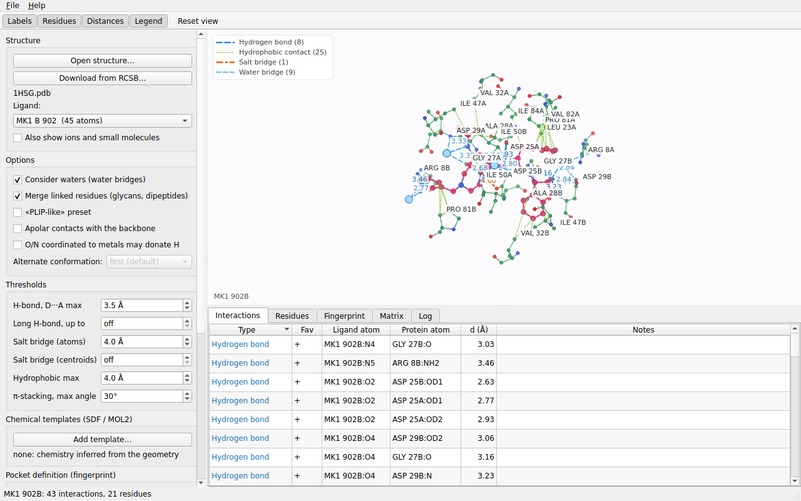
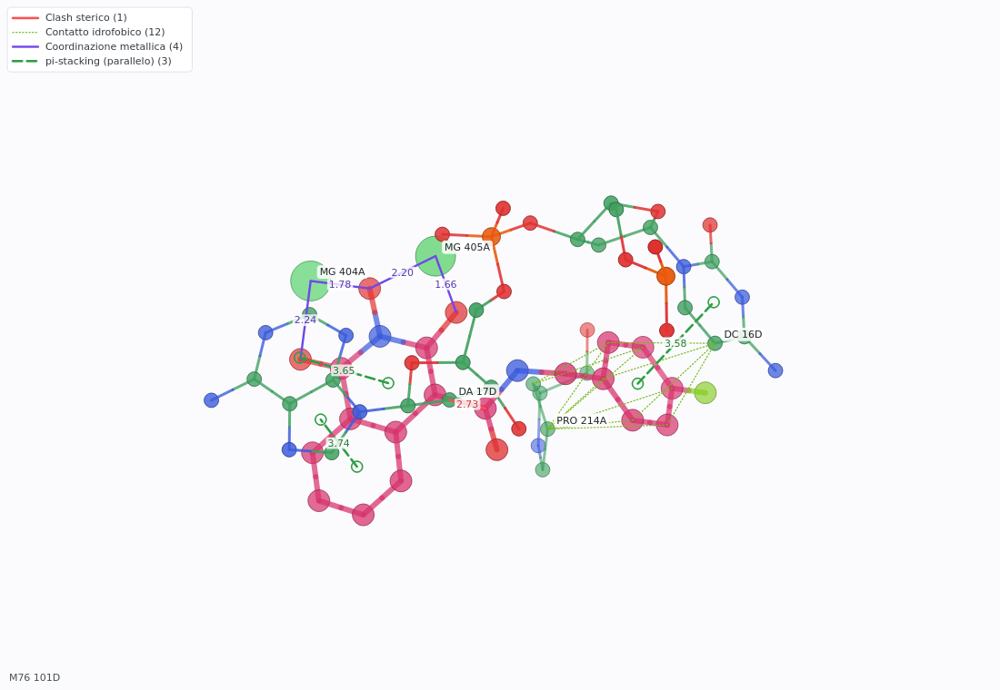

# ligint

Non-covalent **ligand-protein interactions** from a PDB or PDBx/mmCIF file: hydrogen bonds, salt bridges, hydrophobic contacts,
π-stacking, cation-π, halogen bonds, metal coordination and water bridges, plus clashes and repulsions. The project
contains:

| Component | What it is |
|---|---|
| `ligint_core` | C++17 library with no dependencies (API in `include/ligint/ligint.hpp`) |
| `ligint` | command-line program (readable table or CSV) |
| `ligint-gui` | Qt graphical interface with a 3D view of the interactions, tables, filters and the fingerprint figure |
| `tests/` | C++ tests, Python suite, GUI smoke test, comparison with PLIP |



## Installation

Installers are attached to each [release](https://github.com/maxbar64/LigInt/releases): a `.deb` package and a portable
archive for Linux, an `.rpm` for Rocky Linux / AlmaLinux / RHEL 9, an installer (`.exe`) and a portable `.zip` for Windows.

```
sudo apt install ./ligint_<version>_amd64.deb      # Debian, Ubuntu (Qt 6 dependencies are installed automatically)
sudo dnf install ./ligint-<version>-1.x86_64.rpm   # Rocky Linux, AlmaLinux, RHEL 9 (Qt 6 from EPEL)
```

On Windows run `ligint-<version>-win64.exe` (it can add ligint to the `PATH`). Details, the files, how to build the
installers yourself and what has been verified are in [`docs/INSTALL.md`](docs/INSTALL.md). To build from source see
[Building](#building) below.

## Manual

The **user manual** is in HTML: it opens from the **Help** menu of the graphical interface (`F1` shows the page of the tab you are
looking at), with a table of contents, full-text search and navigation, and the same pages are installed as files in the documentation
folder (`/usr/share/doc/ligint/manual/index.html` on Linux) to read in any web browser. Its sources are Markdown files
(`docs/manual/` and the other files of `docs/`), converted by `tools/build_manual.py`; see
[`docs/manual/index.md`](docs/manual/index.md).

## Interaction fingerprints

A fingerprint is a table with one row per protein residue and one column per interaction class (hydrophobic,
aromatic face-to-face and edge-to-face, H-bond donor and acceptor, ionic positive and negative, ...). It can be exported
to CSV/JSON, drawn as an SVG figure with the residues grouped by pocket region, and shown in the GUI. A plain-text
**pocket definition** (residue, position label, region) turns it into the usual pocket-position figure; without it the
residues in contact are listed by number. See [`docs/FINGERPRINT.md`](docs/FINGERPRINT.md).

```
ligint structure.pdb LIG --fingerprint svg --pocket pocket.tsv > figure.svg
```


## Building

Requirements: **CMake ≥ 3.16**, a **C++17** compiler; for the GUI **Qt 6** (or Qt 5) with Widgets and Concurrent.
If Qt is not found, CMake warns and builds only the library and the command line.

```
cmake -S . -B build -G Ninja -DCMAKE_BUILD_TYPE=Release
cmake --build build
ctest --test-dir build --output-on-failure      # with QT_QPA_PLATFORM=offscreen if there is no display
cmake --install build --prefix /installation/path
```

With CMake ≥ 3.21 you can use the presets: `cmake --preset release && cmake --build --preset release`
(other presets: `debug`, `cli-only`, `sanitize`).

| CMake option | Default | Meaning |
|---|---|---|
| `LIGINT_BUILD_CLI` | ON | `ligint` executable |
| `LIGINT_BUILD_GUI` | ON | `ligint-gui` (requires Qt; if missing, a warning and the build continues) |
| `LIGINT_GUI_WITH_SVG` | ON | fingerprint figure in the GUI (needs the Qt Svg module; without it the GUI shows the table only) |
| `LIGINT_BUILD_TESTS` | ON | tests registered in CTest |
| `LIGINT_SANITIZE` | OFF | AddressSanitizer + UBSan (GCC/Clang; better without the GUI) |
| `LIGINT_WARNINGS_AS_ERRORS` | OFF | compiler warnings as errors |
| `LIGINT_BUILD_SCREENSHOT_TOOL` | OFF | `ligint-screenshot`, for the documentation images |

## Usage

### Command line

```
ligint structure.pdb                       list the ligands (HETATM) present, with the number of copies (structure.cif works the same way)
ligint structure.pdb ATP                   analyze all ATP ligands
ligint structure.pdb ATP A 501             only chain A, residue 501 (501A = with insertion code A, 501- = without a code)
ligint structure.pdb ATP --altloc B        use alternate conformation B (the listing shows which ones the file has)
ligint structure.pdb ATP --csv             CSV output (service information goes to stderr)
ligint structure.pdb LIG --sdf lig.sdf     chemical annotation from SDF (also --mol2)
ligint structure.pdb LIG --plip-like       preset for the comparison with PLIP
ligint structure.pdb LIG --fingerprint csv|json|svg [--pocket FILE]   interaction fingerprint instead of the table
ligint structure.dat LIG --format cif      force the input format (default: recognized from the content)
ligint --download-pdb 3EYG STI --csv       download an entry from the RCSB and analyze the ligand STI in one command
ligint --klifs-pdb 3EYG --klifs-chain A --klifs-mapping map.tsv --klifs-output pocket.tsv     a kinase pocket definition from a KLIFS mapping
ligint numbered.pdb CAU --fingerprint svg --gpcrdb-positions 3x32,3x33,6x48 > figure.svg   a GPCR pocket by generic residue numbers (GPCRdb)
ligint --matrix ligands.tsv --pocket pocket.tsv --matrix-format svg > matrix.svg     the interaction matrix of the ligands of a list (CSV, JSON or heat map)
ligint --help                              thresholds and default values
```

Options: `--csv`, `--no-water`, `--no-merge`, `--plip-like`, `--sdf F`, `--mol2 F`, `--metal-donors`,
`--backbone-hyd`, `--altloc X`, `--format F`, `--download-pdb ID` (and `--download-*`), `--klifs-*`, `--matrix LIST` (and `--matrix-*`), `--gpcrdb-*`, `--hb-long X`, `--salt-centroid X`, `--fingerprint FORMAT`, `--pocket FILE`, `--version` and all the thresholds (`--hb-max`, `--salt-max`,
`--hyd-max`, ...; see `--help`). Unknown options, non-numeric thresholds or missing files end with an error
(exit code 1); thresholds above 6 Å for the grid searches are limited with a warning.

The CSV columns are `ligand,type,favorable,ligand_atom,protein_atom,distance,notes`; the interaction types are
listed below and are available as constants in `ligint::type`.

### Graphical interface

```
ligint-gui [structure.pdb|structure.cif]
```

Open a PDB (menu, drag and drop or argument), choose the ligand, adjust options and thresholds, press **Analyze**.
The 3D view (drag: rotate; right or middle button: pan; wheel: zoom; double click: reset) shows the ligand in its protein
(cartoon, optional molecular surface), the residues in contact, ions and waters, with the interactions colored by type,
distances, labels and a legend. It is drawn by the program itself, without a graphics card or a web engine.
Selecting a row of the table highlights the interaction in the view. You can filter the types, add SDF/MOL2
ligand structures, export the interactions to CSV and save the image as PNG. The **Fingerprint** tab shows the figure and the
table (pocket definition loaded from the control panel; export to SVG, CSV or JSON). The analysis runs in a separate thread.

**Reproducing a GUI analysis outside the GUI.** After each analysis the *Log* tab shows the equivalent `ligint` command, and
*File > Copy command line* (Ctrl+Shift+C) copies it; *Copy fingerprint command line* gives the same analysis with
`--fingerprint svg` and the pocket definition currently loaded. The command contains only the settings that differ from the
defaults, with the PLIP-like preset written out as the explicit options it sets. It is quoted for POSIX shells (bash, zsh);
for `cmd` or PowerShell the quoting must be adapted. Ligand structure and pocket files appear with their absolute paths, so the command
works as long as the files stay where they are. A ligand with a blank chain ID is selected with the chain `' '`. The tests run
the generated commands through a shell with the real CLI and compare the result with the one shown by the GUI.



### As a library

```cpp
#include <ligint/ligint.hpp>

ligint::Options opt;
opt.ligName = "ATP";
opt.params.applyPlipLike();                    // optional
ligint::Result r = ligint::analyzeFile("1ATP.pdb", opt);
for (const auto& lig : r.ligands)
    for (const auto& h : lig.hits)             // type, atoms, distance, coordinates for the graphics...
        std::cout << h.type << " " << h.ligandAtom << " " << h.proteinAtom << " " << h.distance << "\n";
```

The library prints nothing: warnings and information are in the `Result`. `printText` and `printCsv` reproduce the
command-line output. In another CMake project, after `cmake --install`:

```cmake
find_package(ligint REQUIRED)
target_link_libraries(my_program PRIVATE ligint::core)
```

## What it recognizes (default thresholds)

| Type | Criterion |
|---|---|
| Hydrogen bond | D···A 2.2–3.5 Å, compatible donor and acceptor; with known H: D–H···A ≥ 120° and H···A ≤ 2.7 Å, otherwise antecedent angle ≥ 90° (amines with three substituents: N–H axis within 50°) |
| Salt bridge | opposite charges, atoms ≤ 4.0 Å; with an H-bond on the same pair a single row "also hydrogen bond" |
| Electrostatic repulsion | like charges ≤ 4.5 Å |
| Hydrophobic contact | apolar C–C at 3.3–4.0 Å (carbons not bonded to N/O/P) |
| pi-stacking | centroids ≤ 5.5 Å; parallel (normals ≤ 30°, planes 3.0–4.5 Å apart, offset ≤ 3.5 Å) or T-shaped (≥ 60°, offset ≤ 2.0 Å) |
| Cation-pi | cation–centroid ≤ 6.0 Å, within 30° of the ring axis |
| Halogen bond | Cl/Br/I···N/O/S ≤ 3.5 Å, C–X···A angle ≥ 140° (fluorine is not considered) |
| Metal coordination | O/N with a lone pair or S within the per-element limit (Mg 2.5; Zn 2.6; Ca 2.8; ...) |
| Water bridge | water 2.2–3.5 Å from both ligand and protein, ligand–O–protein angle 75–140°, without direct contact |
| Steric clash | distance < sum of the van der Waals radii − 0.5 Å |
| Possible covalent bond | distance < 2.0 Å |

### Chemical assumptions

Crystallographic PDB files have no hydrogens, so the ligand chemistry is inferred from the geometry:

- **Physiological pH:** carboxylates, phosphates and sulfonates (two terminal O on the same atom) are anionic;
  aliphatic amines with only sp3 substituents, and amidines and guanidines not in a ring, are cationic.
- **Amides:** an N bonded to a carbonyl C is not an acceptor. A ring N with a lone pair is an acceptor.
- **Metals:** O/N coordinated to a metal are considered deprotonated (not donors) unless `--metal-donors`;
  His and other N bound to a metal make no H-bonds.
- **Histidine:** donor and acceptor, never charged.
- **Protein:** DNA/RNA are partners (phosphates, bases, stacking); if the PDB contains the protein hydrogens they are used.
- **PDB and PDBx/mmCIF** files are read; the format is recognized from the content (see [`docs/INPUT_FORMATS.md`](docs/INPUT_FORMATS.md):
  columns used, chains of several characters, limits; gzip-compressed files must be decompressed first).
- **Only the first model is read.** For residues with alternate locations (altloc) the first conformation encountered is kept,
  or the one given with `--altloc X` (GUI: *Alternate conformation*): a residue that does not have it keeps its first one. The
  program reports for how many residues the requested conformation was used and warns if the file does not have it. The
  choice applies to the whole structure, ligand and waters included; occupancies are not considered.
- **Multi-residue ligands** (disaccharides, glycans, dipeptides) covalently linked are a single ligand
  (as in PLIP); `--no-merge` keeps them separate.

### SDF and MOL2

`--sdf` / `--mol2` load a **ligand structure** containing coordinates, bond orders, explicit hydrogens and formal charges. With a ligand residue specified on the command line, the PDB/mmCIF ligand is chemically annotated by matching heavy atoms **by coordinates** (tolerance 0.6 Å, same number of heavy atoms). If matching fails, geometric heuristics are used.

Without a ligand residue argument, the **first molecule** from the imported SDF/MOL2 is analyzed directly by default; `--external-index N` selects another molecule (1-based) as an **external ligand pose**, even when no corresponding ligand is present in the receptor file. Its coordinates must share the receptor coordinate frame. Explicit hydrogens can improve donor/acceptor assignments and D–H···A geometry. SDF V3000 is not supported.

### Presets and options for the comparison with PLIP

- `--hb-long 4.1`: H-bonds with D···A up to 4.1 Å only if the H (real or ideal) can point to the acceptor.
- `--salt-centroid 5.5`: salt bridges between the centroids of the charged groups (one contact per group).
- `--plip-like` = `--hb-long 4.1 --salt-centroid 5.5 --hal-max 4.0`; explicit options take precedence.

They are off by default: `--hb-long` was confirmed on data not used for the tuning, `--salt-centroid` has a small and
uncertain effect.

## Verification

```
ctest --test-dir build --output-on-failure           core_unit + python_suite + gui_smoke
python3 tests/run_tests.py [--bin build/src/ligint] [--sanitize]     112 Python tests (chemical rules, SDF/MOL2,
                                                     parsing, malformed input, real complexes in tests/data)
python3 tests/compare_plip.py *.pdb                  ligint against PLIP (pip install plip openbabel-wheel)
python3 tests/benchmark.py folder/ --groups g.txt    full pipeline with report and CSV of the disagreements
```

**Agreement with PLIP** (one copy per ligand and PDB; sensitivity = PLIP interactions found; precision =
ligint interactions also present in PLIP; 95% intervals by bootstrap over the structures):

| Group | Sites | Sensitivity | Precision |
|---|---:|---|---|
| A, B (used for the corrections) | 84 | 81% [77–84] | 75% [71–78] |
| C (blind, examined afterwards) | 83 | 77% [73–80] | 70% [66–73] |
| D (blind), default | 47 structures | 75% [70–80] | 70% [66–74] |
| D, `--plip-like` | 47 structures | 79% [74–84] | 70% [65–74] |

Details, method and limits in [`docs/BENCHMARK.md`](docs/BENCHMARK.md); reports and CSV of the disagreements in `docs/benchmark/`.
**PLIP is not the truth:** many disagreements are conventions (see below), and the comparison does not replace a
validation with experimental data.

## Known limits and differences from PLIP

- PLIP counts **fluorine** halogen bonds too; ligint does not.
- PLIP treats **histidine as positively charged** (about a third of the missing salt bridges); ligint does not.
- PLIP counts hydrophobic contacts of carbons of polar residues and of heme; ligint limits them to hydrophobic residues.
- **Water bridges:** PLIP applies its own filters (a donor already in an H-bond cannot form a bridge, at most two
  bridges per donor water); ligint does not and reports many more bridges (precision ≈ 40%).
- PLIP does not analyze nucleic acids as partners; ligint does (not validated against a reference).
- Not covered: SDF V3000, NMR structures with several models, pH values other than physiological, covalent bonds with the
  protein (only flagged as "possible covalent bond"), real SDF/MOL2 files from docking (only the 1EFY SDF and a synthetic
  MOL2 were tried).

## Test status

Verified: Linux, GCC 13 and Clang 18 with `-Wall -Wextra -Werror`, Qt 6.4 with the offscreen platform (smoke test and
screenshots), build with ASan+UBSan, installation and use as a CMake package. **Not verified:** macOS and Windows, Qt 5
(the code avoids Qt6-only APIs, but it was not compiled). The workflows in `.github/workflows/` **have never been
run**: the commands are the ones tried here locally on Linux (including `-Werror`, clang and sanitizers), but the first
run on GitHub may need adjustments. The GUI was tried in offscreen mode: interactive use with mouse and dialog boxes
was not tried by hand.

## Layout

```
include/ligint/ligint.hpp   public API
src/core/                   library: analysis.cpp, pdb.cpp, mmcif.cpp, chemistry.cpp, templates.cpp, report.cpp, fingerprint.cpp, svg.cpp, internal.hpp
src/cli/main.cpp            command line
packaging/                  icon, desktop entry, manual pages, Windows resources (installers: see docs/INSTALL.md)
gui/                        Qt GUI (MainWindow, ViewerWidget, SvgView, HitsModel, Style) and screenshot tool
tests/                      unit/ (C++), gui/ (smoke test), run_tests.py, compare_plip.py, benchmark.py, data/ (test PDB and mmCIF files)
docs/                       ARCHITECTURE.md, BENCHMARK.md, benchmark/ (reports), img/
cmake/                      CMake package configuration and packaging (CPack) files
```

Other documents: [`docs/manual/index.md`](docs/manual/index.md) (the manual), [`docs/RCSB.md`](docs/RCSB.md), [`docs/KLIFS.md`](docs/KLIFS.md), [`docs/MATRIX.md`](docs/MATRIX.md), [`docs/GPCRDB.md`](docs/GPCRDB.md), [`docs/INPUT_FORMATS.md`](docs/INPUT_FORMATS.md), [`docs/INSTALL.md`](docs/INSTALL.md), [`docs/FINGERPRINT.md`](docs/FINGERPRINT.md), [`docs/ARCHITECTURE.md`](docs/ARCHITECTURE.md), [`CONTRIBUTING.md`](CONTRIBUTING.md), [`CHANGELOG.md`](CHANGELOG.md).

## License

MIT, see [`LICENSE`](LICENSE) (the copyright holder is a placeholder: change it before publishing). The PDB files in
`tests/data/` are Protein Data Bank data (public domain, CC0); `1efy.sdf` was generated with Protoss
(ProteinsPlus) from PDB entry 1EFY.
