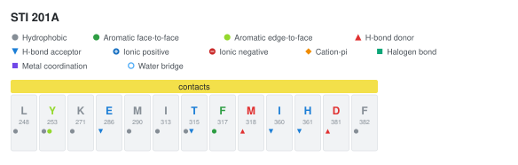
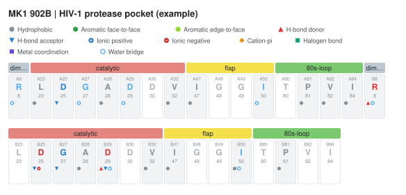
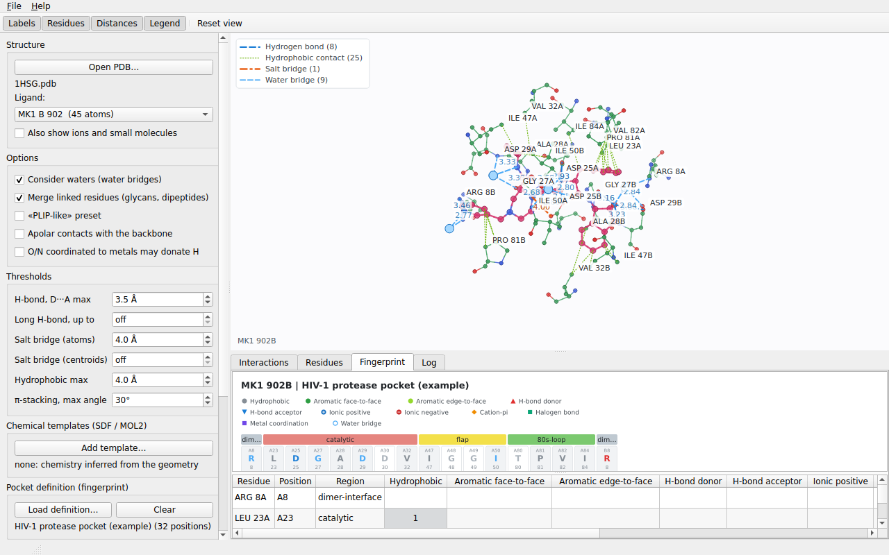

# Interaction fingerprints

A fingerprint summarizes the interactions of one ligand as a table with **one row per protein residue and one column
per interaction class**. It can be exported to CSV and JSON, drawn as an SVG figure (residues grouped by pocket region,
one glyph per class) and shown in the GUI. It is the kind of table/figure used to compare how different ligands use the
same binding pocket.



## Classes

| Column | Meaning | Derived from |
|---|---|---|
| `hydrophobic` | hydrophobic contact | *Hydrophobic contact* (and *Apolar contact (backbone)*) |
| `face_to_face` | aromatic face-to-face | *pi-stacking (parallel)* |
| `edge_to_face` | aromatic edge-to-face | *pi-stacking (T-shaped)* |
| `hbond_donor` | the **protein residue donates** the hydrogen | *Hydrogen bond*, protein atom is the donor |
| `hbond_acceptor` | the **protein residue accepts** the hydrogen | *Hydrogen bond*, protein atom is the acceptor |
| `ionic_positive` | salt bridge with a positively charged residue | *Salt bridge*, charge of the protein atom |
| `ionic_negative` | salt bridge with a negatively charged residue | idem |
| `cation_pi` | cation-pi | *Cation-pi* |
| `halogen` | halogen bond | *Halogen bond* |
| `metal` | metal coordination | *Metal coordination* |
| `water_bridge` | water-mediated contact | *Water bridge* |

The first seven classes are the ones of the usual kinase-ligand fingerprint figures; the others are extras. Each cell of
the table is a **count of contacts** (the JSON also gives the shortest distance per class). A salt bridge that is also an
H-bond counts in the ionic class and in the donor/acceptor class. Clashes, repulsions and possible covalent bonds are
not part of the fingerprint.

**Caveats.** The donor/acceptor role and the charge of each residue come from the same geometric heuristics as the
interactions (histidine is never charged, amines and carboxylates follow the assumptions in the README). The classes are
*not* guaranteed to coincide with the definitions of other tools: measure before treating them as equivalent.

## Command line

```
ligint structure.pdb LIG --fingerprint csv                       one row per residue in contact
ligint structure.pdb LIG --fingerprint json
ligint structure.pdb LIG --fingerprint svg > figure.svg
ligint structure.pdb LIG --fingerprint figure.svg
ligint structure.pdb LIG --fingerprint report.csv
ligint structure.pdb LIG --fingerprint report.json
ligint structure.pdb LIG --fingerprint svg --pocket pocket.tsv   with a pocket definition
```

- `--fingerprint csv|json|svg` writes to standard output (legacy behavior). `--fingerprint OUTPUT.csv|OUTPUT.json|OUTPUT.svg` writes directly to the named file, inferring the format from its extension; an unsupported extension is rejected. The directory must already exist and the output file is overwritten. Diagnostics remain on standard error.
- `--fingerprint` replaces the interaction table (the service information goes to stderr, as with `--csv`).
- CSV and JSON contain every ligand found (a `ligand` column / one object per ligand). The SVG draws only the first
  ligand and warns on stderr if there are more: select one with the chain and residue number.
- `--pocket` needs `--fingerprint`. Unknown formats, missing files and `--pocket` alone end with an error (code 1);
  malformed lines of the pocket file are skipped with a warning.

CSV columns: `ligand,residue,chain,resi,position,region` followed by one count column per class
(`hydrophobic,face_to_face,edge_to_face,hbond_donor,hbond_acceptor,ionic_positive,ionic_negative,cation_pi,halogen,metal,water_bridge`).

## Pocket definition file

The pocket definition is **data, not code**: a text file that says which residues form the pocket, in which order and
how they are grouped. Without it the fingerprint lists only the residues in contact, sorted by chain and number. With it,
every position is listed (also those without interactions, as in the usual figures) in the order of the file, and the
contact residues that are not in the definition are appended and flagged (`in_pocket` = false).

```
# comment
@name HIV-1 protease pocket (example)
@color catalytic #e5857f
A	25	A25	catalytic	ASP
A	50	A50	flap	ILE
```

- One position per line: **chain, residue number, position label, region [, residue name]**. Fields are separated by
  tabs or commas (then they may contain spaces) or, if neither is present, by whitespace.
- The residue number accepts an insertion code (`134A`). The chain `*` (or `-`, `_`) matches any chain.
- The region groups consecutive positions in the figure (a colored bar); the order of the file is the drawing order.
- The residue name is optional: it labels the positions that have no contact, and a mismatch with the structure is
  reported as a warning.
- `@name` sets the title and `@color REGION #rrggbb` sets the color of a region; other `@` directives are ignored with a warning.
- A numbering is specific to a structure: a different structure of the same protein needs its own file (or an
  alignment-based mapping, which is not part of the tool yet).

An illustrative file is in [`examples/hiv-protease-pocket.tsv`](examples/hiv-protease-pocket.tsv) (the regions and
labels are an example of the format, **not** a reference mapping). It produces:



## GUI

The **Fingerprint** tab shows the figure and the table. *Load definition...* in the control panel loads a pocket file
(*Clear* removes it); the tab updates immediately. **File > Export fingerprint...** saves SVG, CSV or JSON (chosen by the
extension). The figure needs the Qt Svg module; without it the GUI shows the table only.



## Library

```cpp
#include <ligint/fingerprint.hpp>

ligint::Result r = ligint::analyzeFile("1HSG.pdb", opt);
ligint::PocketDefinition pocket;
std::vector<std::string> warnings;
ligint::loadPocketDefinition("pocket.tsv", pocket, warnings);          // optional
ligint::Fingerprint fp = ligint::makeFingerprint(r.ligands[0], &pocket);
for (const auto& e : fp.entries)
    std::cout << e.residue << " " << e.position << " " << e.counts[ligint::FpHBondDonor] << "\n";
std::string svg = ligint::fingerprintSvg(fp);
```

`writeFingerprintCsv` and `writeFingerprintJson` take a vector of fingerprints (one per ligand). The library does not
depend on Qt.

## Not covered yet

- Mapping residues to pocket positions: the position of each residue in a reference pocket (as defined for kinases, for
  example) is not computed; it must come from the definition file.
- Comparison of the fingerprint with those of other tools.

The fingerprints of several ligands on the same columns, one bit for each position and class, are in the [interaction matrix](MATRIX.md). Pocket definitions for kinases come from [KLIFS](KLIFS.md) and for GPCRs from the generic residue numbers of [GPCRdb](GPCRDB.md).

## Immediate 3D preview on structure import

The GUI now builds the protein 3D geometry when a PDB or mmCIF file is opened, before **Analyze**. The **Interactions 3D** viewer displays the imported protein using the current protein rendering style, initially framed on the entire structure. This preview does not generate ligand interactions, fingerprints or analysis results. After selecting a ligand and running **Analyze**, the same viewer switches to the normal protein–ligand interaction scene. **Reset view** returns to a whole-protein framing while in preview mode. Files without a reconstructible protein backbone still show the normal empty viewer until analysis.

## Ligands in the immediate 3D import preview

Opening a PDB or mmCIF structure now displays **all available HETATM ligands**, in addition to the protein, before **Analyze**. Raw heavy-atom coordinates are displayed as colored spheres; this initial representation does not infer chemistry, bonds, or protein–ligand contacts. Click near a ligand atom in the 3D viewer to select that ligand in the GUI combo box, or change the ligand combo box to focus the selected ligand in 3D. At import the camera initially frames the entire protein. Selection and preview do not produce interaction or fingerprint results, and **Analyze** continues to run the usual chemical/interaction pipeline. The import data are maintained separately from analyzed results, and the preview option is opt-in so CLI ligand-listing behavior is unchanged. In the absence of a protein backbone, available ligand coordinates can still be displayed.


## Bonded ligand preview and estimated hydroxyl hydrogens

The import-only ligand visualization now reconstructs likely heavy-atom covalent bonds from distances and element-dependent covalent radii and coordination limits, rendering those connections in **ball-and-stick**. This is a geometrical approximation: PDB/mmCIF heavy-atom coordinates do not reliably provide ligand bond orders, formal charges, tautomeric states or protonation. The preview therefore does not claim to assign chemically verified bond orders or hydrogen bonds. Analysis and ligand chemical annotation remain independent.

Enable **Preview: estimated hydroxyl H atoms** to display illustrative hydrogen atoms for oxygen atoms with one reconstructed heavy-atom bond where a simple O–H group is plausible. These are labelled `H_EST` internally and placed along the outward O–neighbor vector as a **visual approximation only**. The mode is off by default; it intentionally does **not** protonate nitrogen sites, amide functions, ambiguous oxygens, ionized oxygens or entire molecules. For chemically accurate protonation, use an external chemically validated ligand representation or an explicit template rather than the import preview. The hydrogens are not included in interaction scoring.
