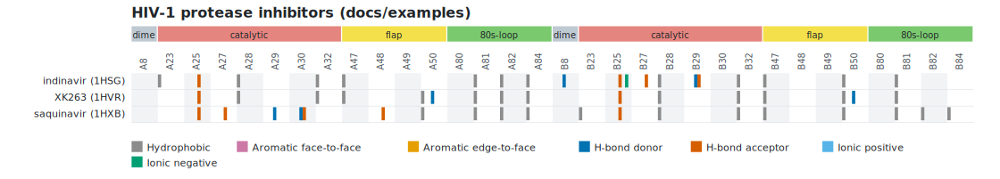

# Interaction matrix

The [fingerprint](FINGERPRINT.md) of a ligand describes one ligand. The **interaction matrix** puts the fingerprints of several ligands, of the same
structure or of different ones, side by side on the **same columns**, so that they can be compared, clustered or given to a program: one row for each
ligand, one column for each pocket position and interaction class, a cell that is **1** if the residue at that position makes at least one favorable
interaction of that class with the ligand and **0** otherwise.

With the 85 positions of a KLIFS pocket and the 7 classes of the KLIFS interaction fingerprint this is a 595-bit fingerprint for each ligand,
comparable across structures because the columns are the pocket positions and not residue numbers. The matrix is written as CSV, JSON or as a heat map in SVG,
on the command line and in the graphical interface.

## The list of ligands

The ligands come from a **list file**: a TSV or CSV file with a header line and one line for each ligand.

```text
# Interaction matrix of three HIV-1 protease inhibitors
structure	ligand	label
../../tests/data/1HSG.pdb	MK1	indinavir (1HSG)
../../tests/data/1HVR.pdb	XK2	XK263 (1HVR)
../../tests/data/1HXB.pdb	ROC	saquinavir (1HXB)
```

| Column | Meaning |
|---|---|
| `structure` | **required**: the PDB or mmCIF file (also called `file`, `path`, `structure_file` or `pdb`) |
| `ligand` | **required**: the residue name of the ligand (`lig`, `resname`, `ligand_name`) |
| `chain` | the chain of the ligand, to choose among several with the same name |
| `resseq` | the residue number, as on the command line: `201` (any insertion code), `201A` (code A) or `201-` (no code) (`resi`, `residue`, `resnum`, `number`) |
| `label` | the name of the row (`name`, `id`, `entry`); by default the file name and the ligand, for example `1HSG MK1 902B` |
| `pocket` | the [pocket definition](FINGERPRINT.md#pocket-definition-file) of this structure (`pocket_file`, `definition`) |
| `altloc` | the alternate conformation to use for this structure (`alt`, `conformation`) |

- The columns can be in any order; other columns are ignored. The separator (a tab or a comma) is recognized from the header line; quoted values
  (`"a, b"`), a byte order mark and Windows line ends are accepted. Blank lines and lines that start with `#` are skipped.
- **Relative paths are relative to the folder of the list**, for the structures and for the pocket definitions.
- Each line must identify **exactly one ligand**. If the name matches several (two copies in different chains), the message lists them and tells to add the
  chain and the residue number. The labels must be different.

## Pocket definitions: all or none

- **With a pocket definition** the columns are the positions of the definition, identified by their label (`46`, `hinge.46`...). Give a definition to
  the whole list with `--pocket FILE`, or to each line with the `pocket` column; a line without one uses the common one. **Either every line has a pocket
  definition, or none does**: otherwise the columns would not mean the same thing for every row, and the program says which line is the problem.
- **Different definitions** are merged: the columns are the union of their positions, in the order of the definitions; a position that only some of them have (for
  KLIFS, a residue that is missing in the crystal in the other structures) goes right after the one that precedes it in its own definition, so that the numeric order
  of the KLIFS positions is kept. A position that is in two definitions with different regions is reported and the first region is used.
- **Without a pocket definition** the columns are the residues that are in contact with some ligand (`ASN 10A`, `LYS 30A`...). This is only meaningful if all the
  structures have the same numbering, for example several ligands of the same protein; for different proteins use a pocket definition.
- A residue in contact with a ligand that is **not in the definition** is not a column. It is reported, with the first residues, as a warning, so that an
  incomplete definition does not go unnoticed.

For kinases the pocket definition of each structure can be made with [KLIFS kinase pockets](klifs.md): one `--klifs-*` command for each structure, and its output in the
`pocket` column. Then position 20 is the same position in every row, whatever the residue number of the kinase.

## Classes

| Option | Columns |
|---|---|
| `--matrix-classes klifs` (default) | the 7 classes of the KLIFS interaction fingerprint: `hydrophobic`, `face_to_face`, `edge_to_face`, `hbond_donor`, `hbond_acceptor`, `ionic_positive`, `ionic_negative` |
| `--matrix-classes all` | all the classes of the [fingerprint](FINGERPRINT.md#classes): also `cation_pi`, `halogen`, `metal` and `water_bridge` |
| `--matrix-classes hydrophobic,hbond_donor` | the classes that you name, always in the order above |

`hbond_donor` and `hbond_acceptor` are named from the point of view of the **protein residue**: the residue donates, or accepts, the hydrogen. Only favorable interactions
count: clashes, repulsions and possible covalent bonds are ignored, as in the fingerprint. A cell is a bit: the number of contacts is not kept, the
[fingerprint](FINGERPRINT.md) has it.

`--matrix-hide-empty` leaves out the positions where no ligand has any interaction (all the classes of the position).

## Output

**CSV** (`--matrix-format csv`, the default): the columns `label`, `structure`, `ligand` and then one column `<position>:<class>` for each position and class, in the order of the
positions and, in each one, of the classes; one line for each ligand, with `0` and `1`. Values with a comma are quoted.

**JSON** (`--matrix-format json`):

```json
{"classes": ["hydrophobic", "..."], "pocket": true,
 "positions": [{"position": "1", "region": "hinge"}, ...],
 "rows": [{"label": "...", "structure": "...", "ligand": "MK1 902B", "residues": ["ASN 10A", ...], "bits": [0, 1, ...]}],
 "warnings": ["..."]}
```

`bits` is in the order of the CSV columns (the cell of position `p` and class `c` is `bits[p * len(classes) + c]`). `residues` has one entry for each position: the residue that the pocket
definition of that line names there (or the one in contact), and an empty text if its definition has no such position (with a KLIFS definition: a residue that is missing in the
crystal).



**SVG** (`--matrix-format svg`, with `--matrix-title TEXT` for a title): a heat map with one row for each ligand and, for each position, a block of one thin stripe for each class,
colored when the bit is set (the legend gives the colors). The regions of the pocket definition are drawn above the positions, with the colors of its `@color` lines. Hovering over a stripe
shows the ligand, the position, the class and the residue. The figure is self-contained (no external resources) and has a white background.

## Command line

```text
ligint --matrix LIST [--matrix-format csv|json|svg] [--matrix-classes klifs|all|NAMES] [--matrix-hide-empty] [--matrix-title TEXT] [--pocket FILE]
```

```text
ligint --matrix docs/examples/hiv-protease-matrix.tsv --pocket docs/examples/hiv-protease-pocket.tsv > matrix.csv
ligint --matrix docs/examples/hiv-protease-matrix.tsv --pocket docs/examples/hiv-protease-pocket.tsv --matrix-format svg --matrix-title "HIV-1 protease inhibitors" > matrix.svg
```

The matrix is written to the standard output; the warnings go to the standard error. The thresholds and the options of the analysis (`--hb-max`, `--plip-like`, `--no-water`, `--altloc`, `--format`, `--sdf`...) apply to
every row. `--matrix` takes no structure on the command line, and it cannot be combined with `--fingerprint`, `--csv`, `--download-pdb` or `--klifs-*`. An error in the list or in an entry
stops the program with exit code 1 and the message `Matrix: Entry N (line L, label): ...`; nothing is written to the standard output.

## Graphical interface

The **Matrix** tab (and **File > Open ligand list for the matrix...**) opens a list, **Compute matrix** builds it in the background with the settings of the left panel and the pocket
definition that is loaded (it is the common one: put the others in the `pocket` column), and shows the heat map (with Qt Svg) and a table with the interactions and positions of each row. **All
interaction classes** and **Hide positions without interactions** are the options `--matrix-classes all` and `--matrix-hide-empty`. **File > Export matrix...** writes SVG, CSV or JSON by extension, and **File > Copy matrix command line** gives the `ligint --matrix ...` command that reproduces it.

## Library

```cpp
#include <ligint/matrix.hpp>

auto entries = ligint::readMatrixList("ligands.tsv");
ligint::MatrixOptions opt;
opt.pocket = "pocket.tsv";                         // optional: the common pocket definition
ligint::InteractionMatrix m = ligint::makeMatrix(entries, opt);
bool set = m.bit(row, position, cls);              // one cell
ligint::writeMatrixCsv(std::cout, m);              // or writeMatrixJson, matrixSvg
```

## Checked and not covered

The tests check, without a network: the list (formats, aliases, quoting, paths, every error with its line), the classes, the matrix with and without pocket definitions, the merge of
different definitions in either order, the selection of one ligand, the warnings, the three outputs (the JSON bits equal the CSV cells; the SVG is well-formed and has one stripe for each bit set),
that each row **agrees with the fingerprint of the same ligand** computed separately (also on the three HIV protease complexes), and corrupted lists.

- The bits are the interactions that ligint computes. **They have not been compared with the interaction fingerprint that KLIFS publishes**: the definitions of the interactions differ, so
  the two can disagree on some cells, and measuring how much is a separate piece of work.
- There is no similarity measure between the rows (Tanimoto and the like): the matrix is the input for them.
